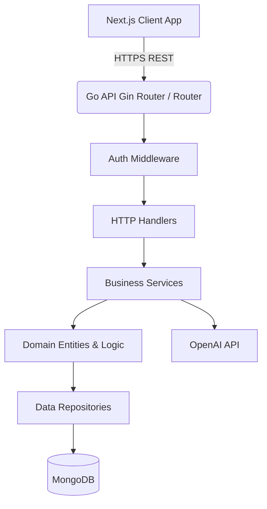

# System Architecture

Hệ thống được thiết kế theo mô hình Client-Server phân tách rõ ràng giữa Frontend và Backend, kết hợp với các dịch vụ ngoại vi (Database, AI).



## Layer Responsibilities (Clean Architecture)

Kiến trúc backend (Go) áp dụng nguyên tắc **Clean Architecture** được tùy chỉnh. Luồng dữ liệu đi theo một chiều từ ngoài vào trong:

1. **Handler (Parse HTTP):**
   - Chịu trách nhiệm nhận HTTP Request (JSON, Query Params).
   - Validate dữ liệu đầu vào.
   - Chuyển tiếp (Delegate) công việc cho Service Layer.
   - Format HTTP Response (JSON) hoặc trả về HTTP Error Code.
   - *Quy tắc:* Tuyệt đối không chứa business logic hay gọi DB.

2. **Service (Business Logic):**
   - Nơi chứa toàn bộ cốt lõi nghiệp vụ của ứng dụng (Business Logic).
   - Gọi nhiều Repository để tổng hợp dữ liệu.
   - Tương tác với các dịch vụ bên thứ ba (như OpenAI).

3. **Domain:**
   - Chứa các định nghĩa Models, Structs và các logic thuần túy (Pure Logic) độc lập hoàn toàn với framework hay DB.
   - Định nghĩa các interface cho Repository.

4. **Repository:**
   - Tầng duy nhất tương tác trực tiếp với cơ sở dữ liệu (MongoDB).
   - Triển khai (Implement) các Interface được định nghĩa ở tầng Domain.
   - Ẩn giấu chi tiết câu lệnh truy vấn MongoDB khỏi Service.

## Folder Structure (Backend)

```text
├── cmd/
│   └── api/
│       └── main.go           # Entry point của ứng dụng
├── internal/
│   ├── handler/              # HTTP handlers (Controllers)
│   ├── service/              # Business logic
│   ├── domain/               # Core models và Repository interfaces
│   ├── repository/           # MongoDB operations
│   ├── middleware/           # JWT, CORS, Logger
│   └── config/               # Load environment variables
├── pkg/                      # Shared libraries (Utilities, Error helpers)
├── docs/                     # Project documentation
└── go.mod
```